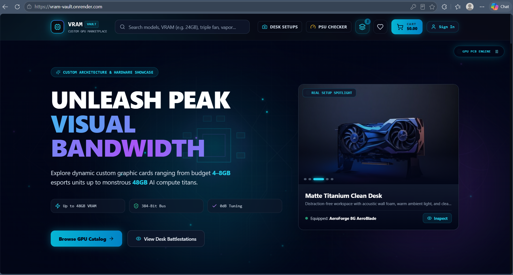
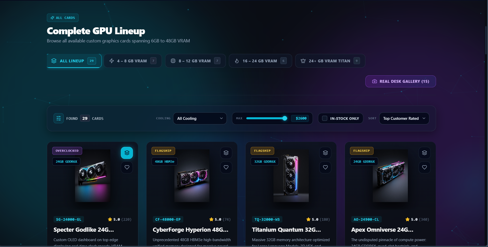
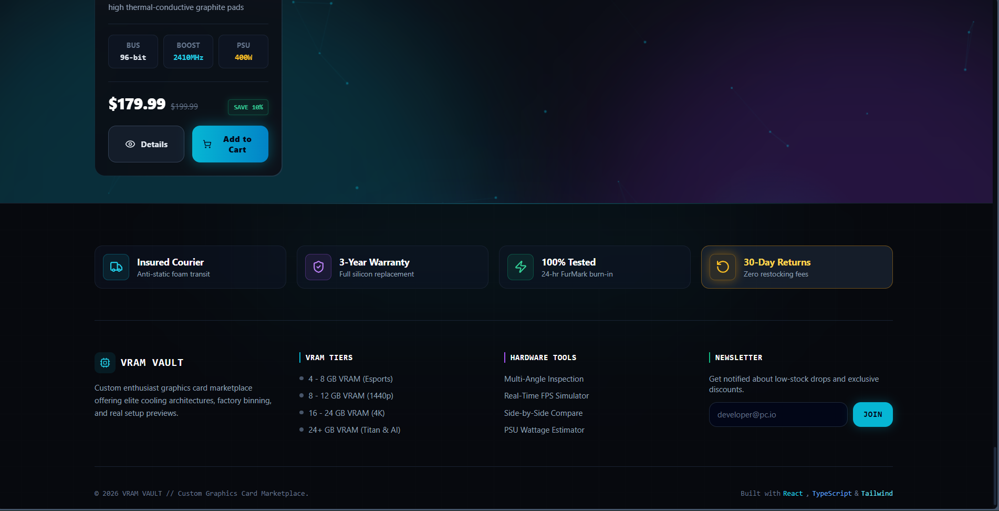

# VRAM Vault

A full-stack e-commerce platform for custom graphics cards, with 29 GPUs across four VRAM tiers, spec filters, side-by-side compare, a PSU checker, a JWT-secured admin panel, and server-side checkout.

**Live demo:** https://vram-vault.onrender.com

> The demo runs on a free hosting plan. If nobody has visited for a while, the first load can take up to a minute while the server wakes up.



## Features

**Shopping**
- Catalog of 29 graphics cards with VRAM tier tabs (4-8 GB, 8-12 GB, 16-24 GB, 24+ GB)
- Filters for cooling type, maximum price and in-stock only, plus sorting
- Search by model, VRAM or cooling
- Product details, wishlist and cart
- Side-by-side GPU compare
- PSU checker for estimating the power supply a card needs
- Desk setup gallery with real setup photos
- Checkout and order history (payments are **simulated**, no real money moves)

**Accounts and admin**
- Sign up and login with JWT authentication
- Role-based access: customer and admin
- Admin panel for managing products and order status, and uploading images to Cloudinary

**Security and reliability**
- Prices and totals are calculated on the server from the database, so the browser can't change what it pays
- Atomic stock updates prevent overselling, with rollback if an order fails
- Admin-only routes enforced on the backend, not just hidden in the UI
- Input validation with Zod, rate limiting on login and the API, security headers with Helmet
- Secrets kept in environment variables, never in the repository

## Tech stack

| Layer | Technologies |
|---|---|
| Frontend | React 18, TypeScript, Vite, Tailwind CSS, Framer Motion, React Router |
| Backend | Node.js, Express 5, Mongoose, JWT, Zod |
| Database | MongoDB Atlas |
| Media | Cloudinary |
| Hosting | Render (one service: Express serves the built frontend and the API) |

## Screenshots

| Catalog | Features and footer |
|---|---|
|  |  |

## Run it locally

**Requirements:** Node.js 18 or newer, a MongoDB Atlas database, a free Cloudinary account.

```bash
# 1. Install dependencies
npm install
cd server && npm install && cd ..

# 2. Create your environment file
cp server/.env.example server/.env
# then fill in the values (see the table below)

# 3. Seed the database (creates the products and the admin account)
npm run seed

# 4. Start the backend and the frontend (two terminals)
npm run server:dev     # API on http://localhost:5000
npm run dev            # frontend on http://localhost:5173
```

### Environment variables (`server/.env`)

| Variable | Purpose |
|---|---|
| `MONGO_URI` | MongoDB Atlas connection string |
| `JWT_SECRET` | Long random string used to sign login tokens |
| `CLOUDINARY_CLOUD_NAME`, `CLOUDINARY_API_KEY`, `CLOUDINARY_API_SECRET` | Image hosting |
| `ADMIN_EMAIL`, `ADMIN_PASSWORD` | Admin account created by the seed script |
| `NODE_ENV` | `development` locally, `production` on the host |

See `server/.env.example` for the full list. Never commit the real `.env` file.

## Deployment

The app deploys as a single Render web service. See [DEPLOYMENT.md](DEPLOYMENT.md) for the exact build and start commands and the environment variables to set.

## What I learned

- Never trust the client for prices: the server recalculates every order total from the database.
- Stock needs an atomic update (`stockUnits >= quantity`) so two buyers can't take the last unit.
- Hiding an admin button isn't security: every admin route checks the role on the server.
- Keeping secrets out of the repo, rotating a key once it leaked, and setting up `.gitignore` before the first commit.

## Author

Built by Harsh Saini as a portfolio project.
